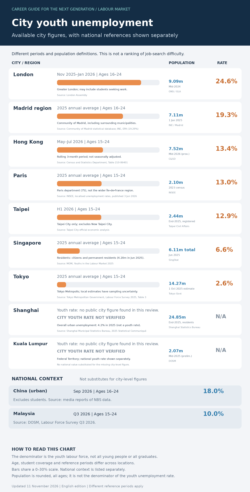

# City youth unemployment: research snapshot

This comparison introduces labour-market research for career planning and geographic arbitrage. A lower youth unemployment rate does not establish that a particular applicant can obtain a job, secure work authorisation, or save more money.

**Snapshot date: 11 November 2026. Repository publication: 15 November 2026.** The chart and dataset preserve the earlier research snapshot; this commit does not constitute a fresh verification of every source or claim. Treat it as a working draft before publication or relocation decisions.

[Download the CSV](../data/city-youth-unemployment.csv) · [Source register](city-youth-unemployment-sources.md)

## Comparison

| City / region | Youth unemployment | Reference period | Age | Population context |
|---|---:|---|---|---|
| Greater London | 24.6% | Nov 2025–Jan 2026 | 16–24 | 9.09m, mid-2024 |
| Madrid region | 19.3% | 2025 annual average | 16–24 | 7.11m, 1 Jan 2025 |
| Hong Kong | 13.4% | May–Jul 2026 | 15–24 | 7.52m, mid-2026, provisional |
| Paris department | 13.0% | 2025 annual average | 15–24 | 2.10m, 2023 census |
| Taipei City | 12.9% | H1 2026 | 15–24 | 2.44m, end-2025, registered |
| Singapore | 6.6% | 2025 annual average | 15–24 residents | 6.11m total; 4.20m residents, Jun 2025 |
| Tokyo Metropolis | 2.6% | 2025 annual average | 15–24 | 14.27m, 1 Oct 2025 estimate |
| Shanghai | Not available in this review | — | — | 24.85m, end-2025, official permanent residents |
| Kuala Lumpur | Not available in this review | — | — | 2.07m, mid-2025 preliminary estimate |

Population values are rounded and refer to all ages. They are **not** the denominators of the youth unemployment rates.

## Interpretation and data limits

- Geography differs: Greater London, a Spanish autonomous community, a French department, municipalities, a metropolis, and city-states are not equivalent urban boundaries.
- Reference periods differ. Annual averages, half-year averages and rolling three-month periods must not be treated as simultaneous observations.
- Student coverage differs. Singapore's youth series concerns citizens and permanent residents; its total population also includes non-residents.
- Hong Kong's age-specific rate is not seasonally adjusted. Adjacent rolling three-month periods overlap.
- Tokyo's local sample estimates may have larger sampling error than national estimates.
- Blank rates are missing values, not zero. National figures must not be substituted for Shanghai or Kuala Lumpur.
- Do not multiply these rates by total city population to estimate unemployed young people.
- Compare occupation-specific junior vacancies, eligibility, language, after-tax earnings and living costs before drawing career conclusions.

## National background, not city observations

The original chart also includes China urban youth unemployment of 18.0% (September 2026, ages 16–24 excluding students) and Malaysia youth unemployment of 10.0% (Q3 2026, ages 15–24). These are national reference figures from the prior review and must not be labelled Shanghai or Kuala Lumpur.

## Shanghai population and disputed youth estimates

Shanghai's official end-2025 permanent resident population is 24.8541 million, including non-local permanent residents. It is not a household-registration-only count.

A historical report of daily service-management population exceeding 30 million uses a broader, different definition. It must not replace the permanent-resident series without changing the label and reference year.

The 46.5% estimate discussed earlier concerns a 2023 nationwide expanded-definition upper-bound calculation attributed to Zhang Dandan. It is **not** an established Shanghai youth unemployment rate, and must not be attributed to Bloomberg as its own Shanghai estimate.

## Maintenance

Keep the observation date, geography, age, denominator, source URL and revision status together. Recheck original tables before changing a value. Preserve corrections in Git history.

The existing repository licence remains unchanged. Source publications and third-party data retain their own applicable rights and terms.
